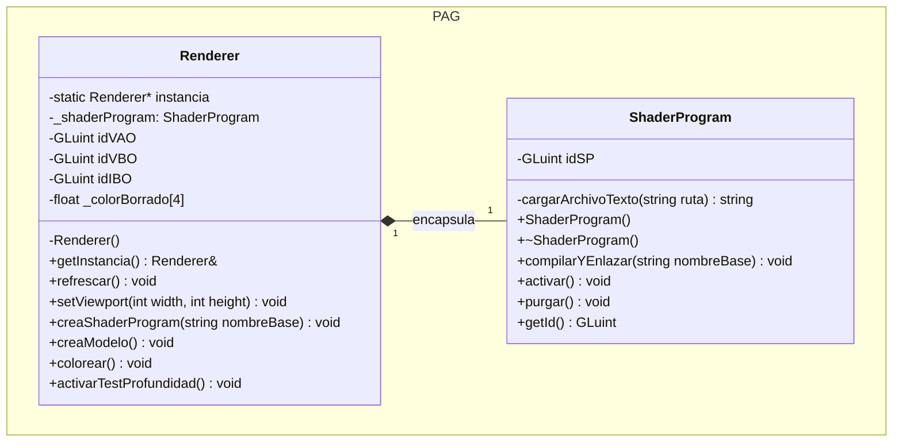

# Ejercicio de reflexión Práctica 1
La incompatibilidad se debe a que los métodos de clase
no estáticos en C++ reciben implicitamente el puntero
"this", por lo que su firma no coincide con las
funciones en C que espera GLFW. Para resolverlo de forma
desacoplada y sin usar variables globales, se utiliza un
User Pointer junto con una Proxy.

1- Asociación: Tras crear la ventana, asociamos la 
instancia del renderer a GLFW mediante 
glfwSetWindowUserPointer(window, &PAG::Renderer).

2- Función Puente: Se registra como callback de GLFW 
una función de C pura (o un método static de la clase).

3- Invocación: Dentro de la función puente, recuperamos 
el objeto con
```
auto* renderer = static_cast<PAG::Renderer*>
(glfwGetWindowUserPointer(window));
```
y llamamos al método miembro correspondiente
(```renderer->refrescarVentana()```).

### Declaración de PAG::Renderer
Debe declararse como una variable local dentro de la función
main. Esto evita uso de variables globales, garantiza encapsulamiento
y asegura que su memoria se libere automáticamente al
finalizar el programa

### Módulo de inicialización
El módulo encargado de inicializarlo debe ser main.cpp.

La instanciación debe realizarse estrictamente después de
crear la ventana con GLFW y haber cargado el contexto con
GLAD, pero antes de entrar en el ciclo de eventos.

# Cambios realizados en la Práctica 3

### 1. Carga externa de Shaders GLSL
* **Separación de código:** Se han extraído los shaders del código fuente en C++ a ficheros de texto independientes: `pag03-vs.glsl` (Vertex Shader) y `pag03-fs.glsl` (Fragment Shader).
* **Lectura dinámica de archivos:** Se ha implementado el método auxiliar `PAG::Renderer::cargarArchivoTexto` mediante `std::ifstream` y `std::stringstream` para leer el contenido del código GLSL desde el disco.
* **Parametrización:** El método `PAG::Renderer::creaShaderProgram(const std::string& nombreBase)` ahora recibe como parámetro el nombre base del archivo (por defecto `"pag03"`), concatenando automáticamente los sufijos `-vs.glsl` y `-fs.glsl`.

### 2. Gestión de Errores y Excepciones
* **Comprobación en OpenGL:** Se han integrado las funciones `glGetShaderiv` (con `GL_COMPILE_STATUS`) y `glGetProgramiv` (con `GL_LINK_STATUS`) para detectar fallos sintácticos en la compilación y enlazado de shaders.
* **Lanzamiento de excepciones:** En caso de fallo, `Renderer` obtiene el log de error mediante `glGetShaderInfoLog` o `glGetProgramInfoLog` y lanza una excepción de tipo `std::runtime_error`.
* **Integración con la interfaz ImGui:** En `main.cpp`, la llamada a `creaShaderProgram` se ha envuelto dentro de un bloque `try-catch`. Los errores capturados se redirigen a la consola gráfica de la ventana "Mensajes" de ImGui a través de `addLog()`, evitando el cierre inesperado de la aplicación.

### 3. Gestión y Limpieza de Recursos
* **Liberación de Shaders:** Tras enlazar con éxito el *Shader Program* (`glLinkProgram`), se desvinculan (`glDetachShader`) y eliminan (`glDeleteShader`) los identificadores individuales del Vertex Shader y Fragment Shader para optimizar la memoria gráfica.
* **Desvinculación de VAOs:** Se ha añadido `glBindVertexArray(0)` al finalizar la configuración en `creaModelo()` y tras realizar las llamadas de dibujo en `refrescar()`.

## Pregunta sobre el triángulo Práctica 3
### Si redimensionas la ventana de la aplicación, verás que el triángulo no permanece igual, sino que se deforma al mismo tiempo que la ventana. ¿A qué crees que se debe este comportamiento?
Esto es debido a que los vértices del triángulo están definidos únicamente
en coordenadas normalizadas en el rango [-1,1], las cuales la GPU estira
directamente para adaptar el tamaño del Viewport (glViewport).

Al redimensionar la ventana cambia su relación de aspecto (ancho/alto),
por lo que el espacio [-1,1] se escala de forma desigual en cada eje. Esto
sucede porque no se está utilizando una matriz de proyección que compense
la proporción de la ventana y mantenga la geometría original del objeto.

# Práctica 4

## Desacoplamiento realizado
La gestión de código GLSL se ha extraído de `PAG::Renderer` hacia la clase
dedicada `PAG::ShaderProgram`:
* `PAG::ShaderProgram`: Encapsula el identificador de OpenGL (`idSP`), la 
lectura de archivos GLSL (`-vs.glsl` y `-fs.glsl`), la compilación individual
de *vertex* y *fragment shaders*, el enlazado, la captura de errores, la 
activación con `glUseProgram` y la liberación de recursos.
* `PAG::Renderer`: Mantiene un objeto miembro `_shaderProgram` de tipo 
`PAG::ShaderProgram` y delega en este tanto la compilación como la activación
durante la fase de refresco de la escena.

## Cambios realizados
1. **Creación de la clase `PAG::ShaderProgram` (`ShaderProgram.h` / `ShaderProgram.cpp`):**
    * Método `compilarYEnlazar(const std::string& nombreBase)` para leer, compilar, enlazar y verificar fallos en tiempo de ejecución.
    * Método `activar()` para vincular el programa activo en el pipeline con `glUseProgram`.
    * Método `purgar()` para eliminar el programa de la memoria gráfica con `glDeleteProgram`.
2. **Refactorización de `PAG::Renderer` (`renderer.h` / `renderer.cpp`):**
    * Eliminación de los atributos `idVS`, `idFS` e `idSP`, así como del método privado `cargarArchivoTexto`.
    * Adaptación de `creaShaderProgram(nombreBase)` y `refrescar()` para delegar la lógica en `_shaderProgram`.
3. **Interfaz Gráfica ImGui en `main.cpp`:**
    * Incorporación de la ventana "Shader Program" con un cuadro de texto (`ImGui::InputText`) respaldado por un buffer `char[256]` nativo y un botón `"Load"` para compilar shaders dinámicamente.
    * Captura de excepciones `std::runtime_error` durante el enlazado o compilación, redirigiendo los mensajes de error a la consola gráfica "Mensajes".
4. **Sincronización de Callbacks con ImGui:**
    * Invocación de `ImGui_ImplGlfw_KeyCallback`, `ImGui_ImplGlfw_MouseButtonCallback` y `ImGui_ImplGlfw_ScrollCallback` dentro de los callbacks de GLFW para permitir la edición interactiva del cuadro de texto (borrado con Backspace, selección y navegación con teclado).

## Diagrama UML


# Práctica 5
## Cambios realizados
### 1. Encapsulacion en la Clase `PAG::Camara`
* **Definición de parámetros:** La cámara almacena su posición en el espacio (`_posicion`), el punto al que mira (`_lookAt`), el vector de orientación vertical (`_up`), el ángulo de visión vertical (`_fovy`), la relación de aspecto del viewport (`_aspecto`) y los planos de corte cercano y lejano (`_zNear`, `_zFar`).
* **Generación de matrices:** Implementación de los métodos `getMatrizVision()` mediante `glm::lookAt` y `getMatrizProyeccion()` mediante `glm::perspective`.
* **Implementación de movimientos:**
   * **Pan / Tilt:** Rotaciones de la dirección de visión sobre el eje local vertical u horizontal respectivamente.
   * **Dolly / Crane:** Traslaciones sobre el plano local de la cámara o sobre el eje vertical $Y$ del mundo.
   * **Orbit:** Rotación en latitud y longitud de la posición de la cámara alrededor del punto de interés (`_lookAt`).
   * **Zoom:** Modificación restringida del ángulo de visión vertical `_fovy`.

### 2. Actualización del Pipeline y Vertex Shader
* **Vertex Shader (`pag03-vs.glsl`):** Incorporación de la variable `uniform mat4 mModelViewProj` para transformar las coordenadas de los vértices del modelo antes de pasar a la fase de rasterización.
* **`PAG::ShaderProgram`:** Método `setUniform(nombre, matriz)` para transferir la matriz `glm::mat4` a la GPU utilizando `glUniformMatrix4fv`.
* **`PAG::Renderer`:** En cada ciclo de refresco (`refrescar()`), el *Renderer* solicita las matrices a la cámara, calcula la matriz combinada $\text{MVP} = \text{Proyección} \times \text{Vista}$ y la envía al *shader program* antes de renderizar la geometría.

### 3. Interacción y Gestión de Eventos
* **Ventana ImGui "Camera":** Ventana dedicada con un selector desplegable (*Combo Box*) para alternar entre los tipos de movimiento (`PAG::TipoMovimiento`) y paneles adaptativos con botones y controles deslizantes (*Sliders*).
* **Arrastre con ratón (`cursor_position_callback`):** Registro de callback en GLFW que detecta cuando el botón izquierdo se mantiene pulsado sobre la ventana de dibujo y traslada la diferencia de píxeles recorridos ($\Delta X, \Delta Y$) al movimiento activo de la cámara.
* **Ajuste de Aspect Ratio:** Modificación de `setViewport` para actualizar dinámicamente la relación de aspecto de la cámara al redimensionar la ventana gráfica.

## Decisión de Diseño y Arquitectura

* **Desacoplamiento Matemático:** La cámara se diseñó como una clase independiente dentro del espacio de nombres `PAG`. De esta forma, el cálculo de trasformaciones matemáticas queda aislado tanto de OpenGL como de la interfaz gráfica.
* **Coordinación desde `PAG::Renderer`:** Se mantiene la arquitectura Singleton de `Renderer` como director principal. `Renderer` posee la instancia de `Camara` y garantiza que la matriz MVP se actualice correctamente en el pipeline en cada fotograma.
* **Prevención de Interferencias con la GUI (`WantCaptureMouse`):** En el callback del movimiento del ratón se comprueba la propiedad `ImGui::GetIO().WantCaptureMouse`. Si el usuario interactúa con controles dentro de una ventana de ImGui, el movimiento de la cámara se bloquea para evitar desplazamientos accidentales.

## Instrucciones de Uso

1. **Control mediante la Ventana "Camera" (ImGui):**
   * Selecciona el movimiento deseado en el menú desplegable **Movement** (*Zoom, Pan, Tilt, Dolly, Crane, Orbit*).
   * Utiliza los botones específicos que aparecen debajo para realizar desplazamientos finos en la dirección elegida.
   * En el modo **Zoom**, ajusta el slider **Angle** para modificar gradualmente el campo de visión.
2. **Control por Ratón (Clic y Arrastre):**
   * Haz clic con el **botón izquierdo del ratón** sobre el lienzo 3D y arrastra en cualquier dirección. La cámara se moverá fluidamente aplicando el tipo de movimiento que esté seleccionado en la ventana "Camera".
3. **Carga de Shaders y Fondo:**
   * Utiliza el panel **Fondo** para cambiar el color de borrado o usa la rueda del ratón.
   * Escribe el nombre base de cualquier shader en el panel **Shader Program** y pulsa **Load** para recompilar en caliente.

## Diagrama UML
```mermaid
classDiagram
namespace PAG {
class TipoMovimiento {
<<enumeration>>
PAN
TILT
DOLLY
CRANE
ORBIT
ZOOM
}

        class Camara {
            -vec3 _posicion
            -vec3 _lookAt
            -vec3 _up
            -float _fovy
            -float _aspecto
            -float _zNear
            -float _zFar
            +getMatrizVision() mat4
            +getMatrizProyeccion() mat4
            +setViewportRatio(float aspecto) void
            +setFovy(float fovy) void
            +pan(float deltaX) void
            +tilt(float deltaY) void
            +dolly(float deltaX, float deltaZ) void
            +crane(float deltaY) void
            +orbit(float deltaLat, float deltaLon) void
            +zoom(float deltaFov) void
        }

        class Renderer {
            -static Renderer* instancia
            -ShaderProgram _shaderProgram
            -Camara _camara
            +getInstancia() Renderer&
            +refrescar() void
            +setViewport(int width, int height) void
            +getCamara() Camara&
        }

        class ShaderProgram {
            -GLuint idSP
            +compilarYEnlazar(string nombreBase) void
            +activar() void
            +setUniform(string nombre, mat4 matriz) void
        }
    }

    Renderer "1" *-- "1" Camara : contiene
    Renderer "1" *-- "1" ShaderProgram : utiliza